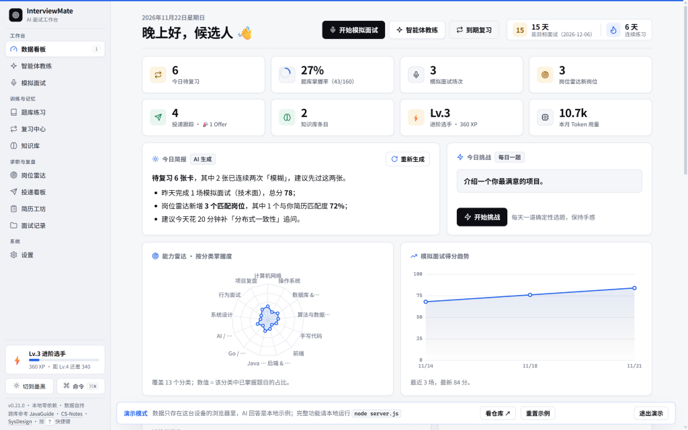
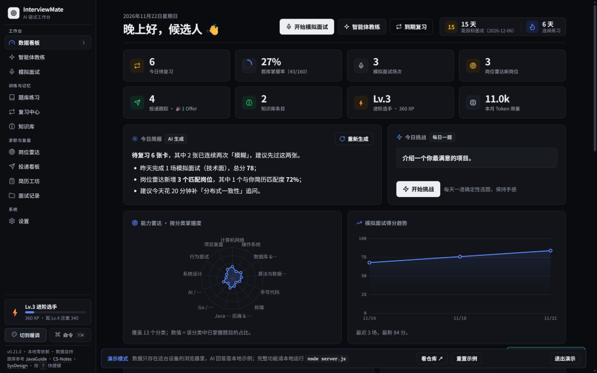
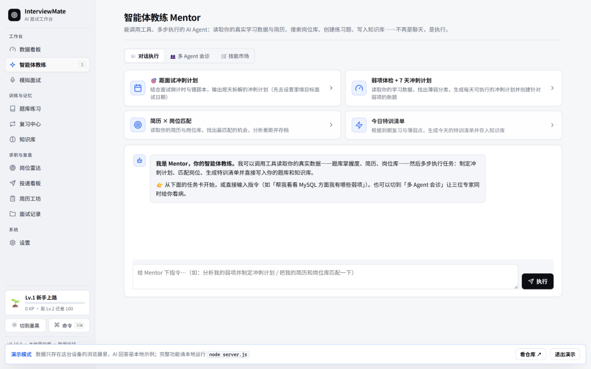
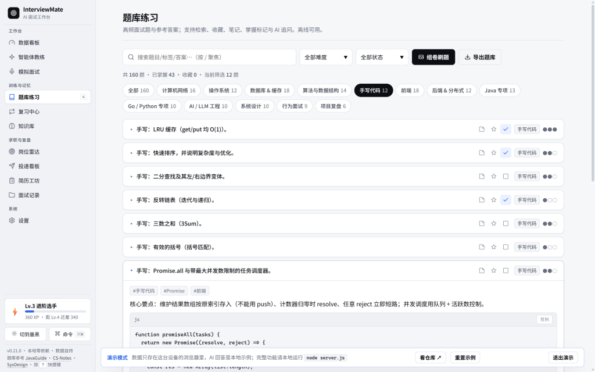

<div align="center">

# 🎯 InterviewMate · AI Interview Workbench

**Your local-first AI interview coach — Agent Mentor, Mock Interviews, Leitner Spaced Repetition, Job Radar, Application Kanban, and Resume Studio. Zero runtime dependencies.**

[](https://github.com/zhengqiuyang/interview-mate/actions/workflows/ci.yml)
[](https://zhengqiuyang.github.io/interview-mate/?demo=1)


<p>
  <a href="https://zhengqiuyang.github.io/interview-mate/?demo=1"><b>👉 Try Live Demo (No Install / No API Key)</b></a> ·
  <a href="./README.md">简体中文</a>
</p>

Zero npm runtime dependencies — no `npm install` required:

```bash
node server.js
```

</div>

---

## 📸 Screenshots (Design System v4 · Precision Workbench)

Three high-contrast token themes (**Swiss Light / Ink Dark / Editorial Warm**), grouped sidebar navigation, `<kbd>⌘K</kbd>` / `<kbd>Ctrl+K</kbd>` command palette, and `<kbd>1</kbd>–<kbd>0</kbd>` single-key view switching.

| Dashboard (Swiss Light) | Dashboard (Ink Dark) |
| --- | --- |
|  |  |
| **Agent Mentor & Missions** | **Question Bank & AI Deep-Dive** |
|  |  |

## ✨ Highlights

- **🤖 Agent Mentor & Multi-Agent Panel**: Prompt-based tool protocol that works with **any OpenAI-compatible model** (OpenAI, DeepSeek, Zhipu GLM, Moonshot Kimi, keyless local Ollama). Calls 10 built-in local tools (`my_stats`, `my_wrong`, `get_profile`, `search_bank`, `add_cards`, `get_resume`, `search_jobs`, `my_applications`, `save_knowledge`, `search_knowledge`) in a multi-step loop, plus a **Skill Market** for custom HTTP tools and expert personas.
- **🎙️ Mock Interviews & Voice Review**: Solo or 4-round campaign mode (Tech → Project → System Design → HR) with **Resume & Long-Term Profile context injection**, full voice loop (TTS + SpeechRecognition + audio recording + filler-word & speaking-speed analytics), and shareable score cards.
- **📚 160+ Question Bank & Open-Source Importer**: 13 categories including **Go/Python** and **AI/LLM Engineering**, fenced Markdown code blocks with one-click copy, plus a built-in **Markdown / GitHub Raw URL importer** to parse any open-source question repo into your personal SRS deck.
- **🔁 Leitner Spaced Repetition & Anki Sync**: 3D flashcards with **Cloze deletion** and **60s timed oral drills**, 26-week practice heatmap, 7-day due forecast, and two-way Anki TSV import/export.
- **📮 Job Radar → Resume Studio → Application Kanban**: Auto-fetch jobs from RemoteOK / Hacker News / custom RSS & JSON feeds with local resume match scoring; native PDF & DOCX preview with structured JD diagnosis; 9-column application tracking board.
- **🔒 Local-First & Hardened**: Zero external server — your API key, notes, resumes, and progress stay in your browser `localStorage` and local `data/` directory. Hardened with loopback `Host` validation (DNS-rebinding protection), strict static CSP headers, two-stage streaming timeouts, and 71 automated `node:test` behavioral tests.

## 🚀 Quick Start

```bash
git clone https://github.com/zhengqiuyang/interview-mate.git
cd interview-mate
node server.js
# Open http://127.0.0.1:3000 (or http://127.0.0.1:3000/?demo=1 for mock demo mode)
```

## 📄 License

[MIT](LICENSE)
