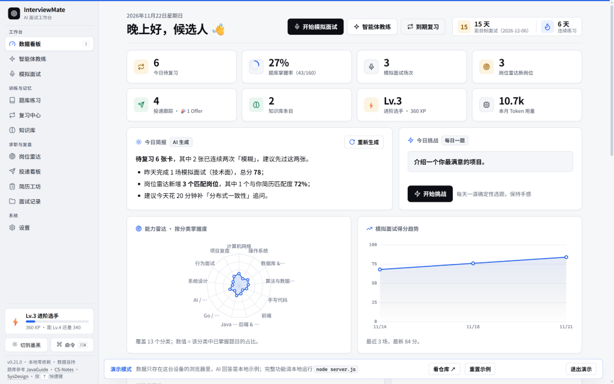
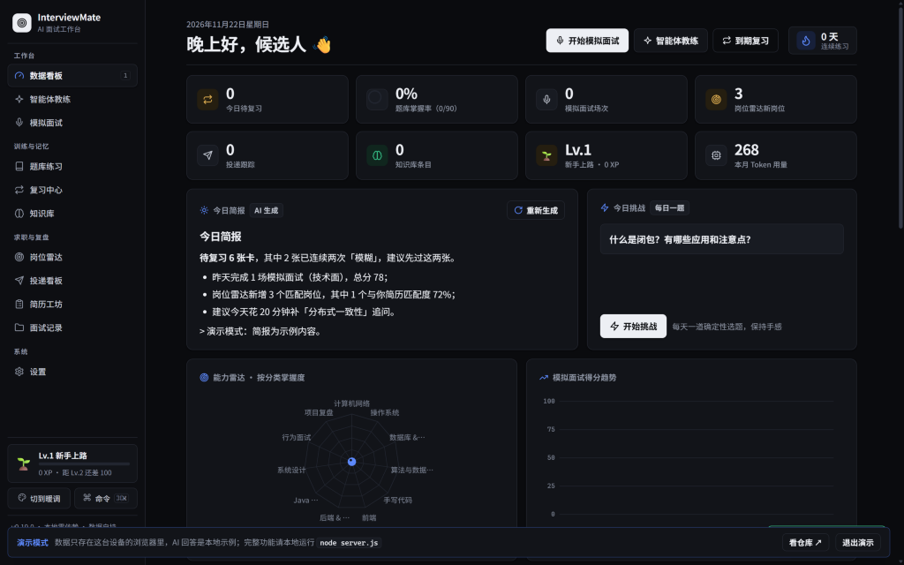
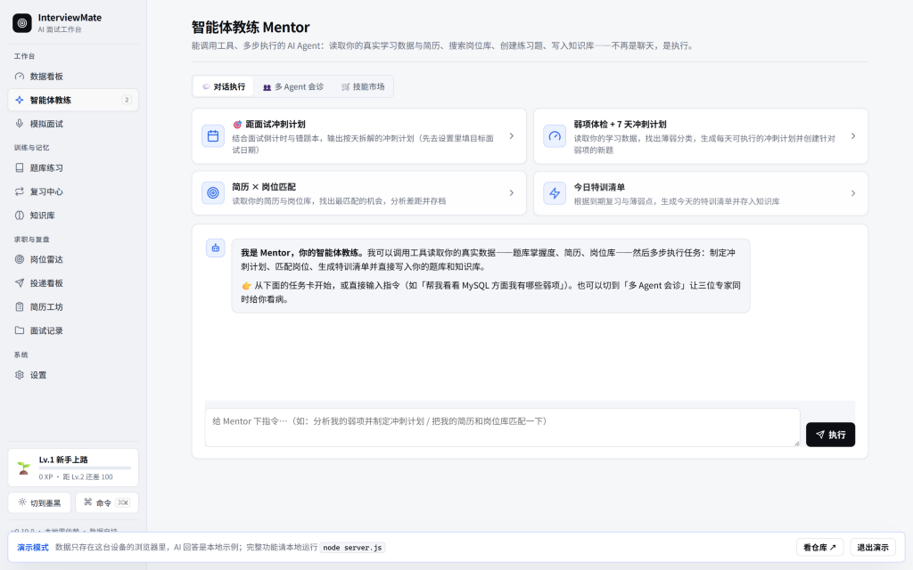
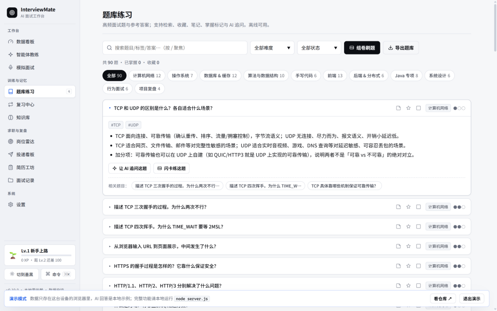

<div align="center">

# 🎯 InterviewMate · AI 面试工作台

**你的私人 AI 面试官 —— 智能体教练 · 模拟面试 · 间隔重复 · 岗位雷达 · 投递看板 · 简历工坊，零依赖本地运行。**

[](https://github.com/zhengqiuyang/interview-mate/actions/workflows/ci.yml)
[](https://zhengqiuyang.github.io/interview-mate/?demo=1)


<p>
  <a href="https://zhengqiuyang.github.io/interview-mate/?demo=1"><b>👉 在线演示（免安装 / 免 API Key）</b></a> ·
  <a href="#features">功能特性</a> ·
  <a href="#quickstart">快速开始</a> ·
  <a href="#arch">系统架构</a> ·
  <a href="#faq">FAQ</a> ·
  <a href="./README.en.md">English</a>
</p>

零 npm 运行时依赖，无需 `npm install`，克隆即跑：

```bash
node server.js
```

</div>

---

**InterviewMate** 参考了 GitHub 上最经典的面试开源项目（CS-Notes、JavaGuide、tech-interview-handbook、system-design-primer 等）的知识分类与题型结构，但走了一条不同的路：**把静态知识库变成 AI Agent 驱动的求职训练工作台**。

- **🤖 智能体教练（Mentor）**：不绑定特定厂商 function calling，基于提示词工具协议实现——**任何 OpenAI 兼容模型**都能调用 10 项本地工具读取你的真实练习数据、简历与岗位库，多步执行并直接把新练习题写入你的题库。
- **🎙️ 模拟面试 + 语音复盘**：单场深度追问或「技术 → 项目 → 系统设计 → HR」四轮闯关；支持整场语音面试（自动播报 + 自动聆听 + 录音回放 + 填充词/语速分析）。
- **🔁 Leitner 间隔重复 + Anki 互通**：闪卡自评「不会 / 模糊 / 掌握」，支持填空（Cloze）与 60s 限时口述，一键与 Anki TSV 双向导入导出。
- **📮 岗位雷达 → 简历工坊 → 投递看板**：自动聚合远程/HN/RSS 岗位并与简历算本地匹配分；PDF/Word 原生预览 + AI 结构化诊断；九列看板跟踪从「已投」到「Offer」全周期。

## 📸 界面预览（Design System v4 · Precision Workbench）

内置 **中性 Swiss / 墨黑 Dark / 手帐暖调 Warm** 三套高对比 Token 主题，支持桌面分组工作台与移动端胶囊导航，`<kbd>⌘K</kbd>` / `<kbd>Ctrl+K</kbd>` 呼出全局命令面板，`<kbd>1</kbd>–<kbd>0</kbd>` 键盘秒切视图。

| 数据看板（中性 Swiss） | 数据看板（墨黑 Dark） |
| --- | --- |
|  |  |
| **智能体教练 Mentor** | **题库练习与 AI 追问** |
|  |  |

<a id="features"></a>

## ✨ 核心功能

### 1. 🤖 智能体教练 Mentor & 多 Agent 会诊

**Mentor** 通过提示词工具协议驱动多步循环（`TOOL: {...}` → 本地执行 → 结果回灌 → 继续推理，最多 4 轮），界面实时渲染每次工具调用与返回负载：

| 内置工具 | 能力说明 |
| --- | --- |
| `my_stats()` | 读取各分类掌握度、待复习数、错题数、模拟面试得分历史、目标面试倒计时 |
| `my_wrong()` | 读取错题本（按挂科次数排序的高频薄弱题） |
| `get_profile()` | 读取历次模拟面试与简历诊断沉淀的**长期用户画像卡**（项目/失分/薄弱/亮点） |
| `search_bank(query)` | 检索题库（含掌握状态与间隔级别） |
| `add_cards(cards)` | **直接创建原创练习题**并入题库与间隔重复系统 |
| `get_resume()` | 读取简历工坊中的当前简历全文 |
| `search_jobs(query)` | 检索岗位雷达已汇集的岗位库 |
| `my_applications()` | 读取投递看板的求职进展、Offer 统计与即将到来的面试安排 |
| `save_knowledge(...)` | **直接写入个人知识库**（冲刺计划、匹配报告自动归档） |
| `search_knowledge(query)` | 检索知识库标题、正文与标签 |

- **👥 多 Agent 会诊**：内置「首席面试官」「求职军师」「复盘教练」三位专家 + 你在**技能市场**安装的自定义专家，**并行调用工具**独立诊断，最后由 Mentor 去重汇总为「本周行动清单 Top 5」。
- **🛒 Agent 技能市场**：支持零代码定义**自定义 HTTP 工具**（由本机服务代理绕开 CORS）与**自定义专家**，内置「薪资谈判教练」「English Interviewer」「首席架构师评委」「GitHub / HN 情报」官方技能包，支持 JSON 一键导入导出分享。

### 2. 🧠 训练、记忆与求职全链路

| 模块 | 核心能力 | 离线可用（免 API Key） |
| --- | --- | --- |
| 📊 **数据看板** | 8 宫格核心指标、每日 AI 简报 + 每日挑战双焦点、分类能力雷达图、得分趋势线、26 周练习年历、7 天复习预测、成就墙、长期画像 | ✅（简报含本地兜底） |
| 🎙️ **模拟面试** | 单场 / 四轮闯关；**语音整场面试**（TTS 播报 + 语音识别 + 同步录音 + 语速/填充词复盘）；量化评分环与可分享成绩单海报 | ❌（需 LLM） |
| 📚 **题库练习** | **90+ 内置高频题、11 大分类**（网络/OS/数据库/算法/手写代码/前端/后端分布式/Java/系统设计/行为面试/项目复盘），收藏、笔记、相关题推荐、AI 追问 | ✅（AI 追问需 LLM） |
| 🔁 **复习中心 & 闪卡** | Leitner 5 级记忆盒子（10 分钟 / 1 / 3 / 7 / 21 天），3D 翻转闪卡、**Cloze 填空模式**、**60s 限时口述**、错题本一键回炉、Anki TSV 双向互通 | ✅ |
| 📡 **岗位雷达** | 订阅公开源（RemoteOK / HN Who is hiring / 自定义 JSON / RSS）定时自动抓取、关键词过滤与去重；**绑定简历后自动计算本地匹配分排序**；AI 岗位情报 | 抓取/匹配 ✅ · AI 情报 ❌ |
| 📮 **投递看板** | 九列状态看板 + 列表双视图（已投 → 约面 → 一/二/三/HR 面 → Offer/挂/搁置），从岗位雷达一键导入，面试倒计时横幅提醒与转化率统计 | ✅ |
| 📋 **简历工坊 2.0** | 上传 **PDF / Word (.docx) / TXT** 本地原生预览 + 启发式/AI 结构化双视图；多版本简历库；针对目标 JD 输出覆盖度、雷达图、追问预测（一键转练习题）与对比润色 | 预览/基础解析 ✅ · AI 诊断 ❌ |
| 🧠 **知识库** | Markdown 笔记 + 标签检索；**AI 剪藏生成学习卡**（贴入文章自动提取 80 字摘要 + 3–8 张问答卡并入复习队列） | 笔记检索 ✅ · AI 剪藏 ❌ |
| 💰 **Token 用量面板** | 自动记录每次请求的真实 `usage`（缺失时中英文加权估算），提供 14 天输入/输出双柱趋势、场景分布、逐笔明细与常见模型成本粗估 | ✅ |

<a id="quickstart"></a>

## 🚀 快速开始

### 方式一：在线演示（零安装）

直接打开 **[https://zhengqiuyang.github.io/interview-mate/?demo=1](https://zhengqiuyang.github.io/interview-mate/?demo=1)**（或本地启动后访问 `http://127.0.0.1:3000/?demo=1`）。
演示模式通过前端 API 适配层（`public/js/demo.js`）拦截 `/api/*`，提供流式打字机回答、示例评估报告与示例岗位库，**与正式版共用 100% 同一套 UI 代码**。

### 方式二：本地完整运行

要求 **Node.js 18+**（零运行时依赖，无需 `npm install`）：

```bash
git clone https://github.com/zhengqiuyang/interview-mate.git
cd interview-mate
node server.js
```

浏览器打开 <http://127.0.0.1:3000> 即可使用。

### 配置模型（任何 OpenAI 兼容接口）

1. 进入左侧栏「**设置**」→ 选择服务商预设（**智谱 GLM** / OpenAI / DeepSeek / Kimi / 本地 Ollama / 自定义）；
2. 填入 API Key，点击「**测试连接**」验证。

> 🔒 **隐私承诺**：API Key 与所有练习进度、笔记、简历均只保存在**你自己的浏览器 `localStorage`**（以及本机 `data/` 目录）中，请求由本机 `server.js` 直接转发至你配置的模型接口，不经过任何第三方服务器。

也支持在项目根目录复制 `.env.example` 为 `.env` 进行服务端配置（页面设置优先级高于 `.env`）：

```ini
INTERVIEW_MATE_API_KEY=你的key
INTERVIEW_MATE_BASE_URL=https://open.bigmodel.cn/api/paas/v4
INTERVIEW_MATE_MODEL=glm-4-flash
HOST=127.0.0.1                               # 设为 0.0.0.0 可允许局域网访问
PORT=3000
INTERVIEW_MATE_DATA_DIR=                     # 可写数据目录，默认仓库 data/
INTERVIEW_MATE_UPSTREAM_FIRST_BYTE_MS=30000  # 上游首字节超时（毫秒）
INTERVIEW_MATE_UPSTREAM_IDLE_MS=120000       # 流式空闲超时（毫秒）
INTERVIEW_MATE_JOB_REFRESH_MIN=30            # 岗位雷达自动抓取间隔（分钟，0=关闭）
```

<a id="arch"></a>

## 🧱 系统架构与质量保障

刻意保持精简：**零依赖 Node.js 服务端 + 原生 ES Modules 前端 + 单层 CSS Token 架构**。

```
┌────────────────────────── 浏览器（ES Modules） ──────────────────────────┐
│  index.html / css/style.css（Design System v4：中性 / 墨黑 / 暖调）       │
│  js/  app.js(入口/命令面板/全局搜索/快捷键)   router.js(视图路由表)        │
│       core.js(存储/图标/Modal/主题/Canvas图表/分享海报)  state.js(状态)    │
│       api.js(SSE流式客户端)   demo.js(?demo=1 静态Mock适配层)             │
│       srs.js(Leitner间隔重复) gamify.js(XP/成就) profile.js(长期画像)     │
│       tokens.js(Token记账)    views/*(12个业务视图模块)                   │
└────────────────────────────────────┬─────────────────────────────────────┘
                                     │ fetch /api/*
┌────────────────────────────────────▼──── server.js（Node 18+，零依赖）───┐
│  · Host Loopback 校验（防 DNS Rebinding）+ 严格静态资源 CSP 响应头         │
│  · POST /api/chat       → 提示词组装 + 两段超时流式代理 + 断开传播        │
│  · GET  /api/questions  → data/questions.json（90+ 高频题库）             │
│  · /api/jobs*           → lib/jobs.js（RemoteOK/HN/RSS/JSON 抓取与去重）  │
│  · /api/agent/briefs*   → lib/briefs.js（服务端定时每日简报）             │
│  · /api/files/*         → 简历原文与语音回答本地持久化（含路径穿越守卫）  │
└──────────────────────────────────────────────────────────────────────────┘
```

### 自动化测试与 CI 门禁

```bash
npm test              # 运行 65 项 node:test 行为测试（SRS / 游戏化 / 岗位纯函数 / 真实 Server & 流式代理 / Quota / Demo 适配层）
npm run lint          # ESLint 9 静态检查
npm run sync-version  # 校验 package.json ↔ sw.js / index.html 版本号单一来源
```

<a id="faq"></a>

## ❓ 常见问题（FAQ）

**Q：不用 API Key 能干什么？**
看板统计、90+ 题库练习、Leitner 间隔重复、3D 闪卡（含填空与限时模式）、每日挑战、知识库笔记、投递看板、岗位雷达抓取与本地简历匹配分、PDF/Word 简历预览、Anki 导入导出、全量 JSON 备份恢复**全部离线可用**。

**Q：国内招聘网站（Boss 直聘、拉勾等）怎么用岗位雷达？**
国内招聘站有强登录与反爬限制，本项目不做违规爬虫。推荐工作流：在招聘页复制 JD 正文 → 岗位雷达点「**手动添加 JD**」→ 一键生成「**AI 岗位情报**」或带入「**简历工坊**」做深度匹配诊断，也可一键导入「**投递看板**」跟踪进度。

## 📄 License & 致谢

[MIT](LICENSE)。题库分类与答题框架参考了 [CS-Notes](https://github.com/CyC2018/CS-Notes)、[JavaGuide](https://github.com/Snailclimb/JavaGuide)、[advanced-java](https://github.com/doocs/advanced-java)、[tech-interview-handbook](https://github.com/yangshun/tech-interview-handbook)、[system-design-primer](https://github.com/donnemartin/system-design-primer)（详见 [docs/references.md](docs/references.md)）。内置文档预览使用 Mozilla [pdf.js](public/vendor/pdfjs/)（Apache-2.0）、[JSZip](https://stuk.github.io/jszip/)（MIT）与 [docx-preview](https://github.com/VolodymyrBaydalka/docxjs)（Apache-2.0）。

欢迎贡献题目、技能包与功能改进 —— 请参阅 [CONTRIBUTING.md](CONTRIBUTING.md)。
